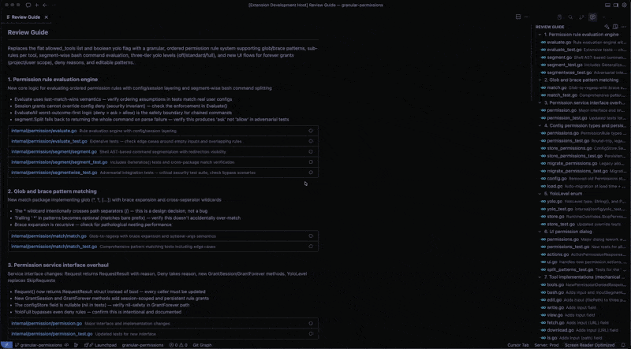

# Revu

Review the branch you're on against the branch it's stacked on, leave private comments, and hand them to your coding agent, all inside VS Code or Cursor.



## Highlights

- **Clean diffs with no setup.** Every branch is compared with its parent from the merge-base, so a stale local `main`, new upstream commits and lower layers of a stack never show up.
- **Knows your stack.** It finds the parent from gh stack, the PR base, or where git says the branch was created, and shows the whole chain with PR state and ahead/behind counts.
- **One-click branch moves.** Switch to any layer's worktree (creating one with `wtp` if needed), pull the default branch, or merge the parent in.
- **Checkpoints.** Mark commits as reviewed and narrow the diff to what's changed since, which suits agents that keep committing while you read.
- **Comments for your agent, not GitHub.** Local, per-branch review comments export as structured markdown. Revu can't write to GitHub at all.

## Why it exists

This is a personal tool built around one review flow. An agent in my terminal harness, [anvil](https://github.com/Broderick-Westrope/anvil), already does AI review, but I still read changes myself:

1. **Get oriented.** See where the branch sits (what it's stacked on, whether it has a PR) and exactly what it changes.
2. **Read and annotate.** Leave comments that are questions and doubts for me, not PR feedback.
3. **Work through them with the agent.** Paste the comments into the terminal and dig in together.
4. **Finalise on GitHub.** Whatever survives becomes real PR feedback through the [GitHub Pull Requests](https://marketplace.visualstudio.com/items?itemName=GitHub.vscode-pull-request-github) extension.

Steps 1 to 3 were spread across tools. [GitLens](https://www.gitkraken.com/gitlens) compares a branch with anything, but doesn't know what it's stacked on and every comparison is set up by hand. [pair-review](https://github.com/in-the-loop-labs/pair-review) reviews local changes, but in a browser. [comment-renderer](https://marketplace.visualstudio.com/items?itemName=statiolake.vscode-comment-renderer) exports editor comments as markdown, but knows nothing about the change under review. Revu puts those ideas in one extension, in the editor where the review happens. Credit to all three.

## Install

Revu isn't on the marketplace. Clone it and run the install script, which compiles, tests, packages and installs the extension into Cursor (or VS Code if Cursor isn't on your PATH):

```bash
git clone https://github.com/Broderick-Westrope/revu && cd revu
npm ci
./scripts/install.sh          # or: ./scripts/install.sh code
```

Reload the editor window afterwards.

**Requirements**

- `git` 2.38 or newer (merge commit rows use `git merge-tree --write-tree`), and an `origin/HEAD` ref or a local `main` or `master` so Revu can find the default branch.
- Optional: an authenticated `gh` for PR state and threads, the `gh stack` extension for exact parents of gh stack layers, and `wtp` on the PATH VS Code sees for switching to a branch that has no worktree yet. Without them Revu finds parents from git alone.

## Usage

Open a branch's folder and click the Revu icon in the activity bar. There's nothing to start; the three views already show the checked-out branch:

| View | What it shows |
| --- | --- |
| **Stack** | The branch's parents down to the default branch and the branches stacked above it, with PR number and state, commits ahead (↑) and behind (↓) its parent, and "needs rebase" from gh stack. The green dot is the branch in this window; a folder icon means it's checked out in another worktree. |
| **Changes** | Files changed against the parent, including uncommitted and untracked files, as a folder tree. The title says which parent won and why, for example `vs feat/port (inferred)`. |
| **Checkpoint** | Commits since the last one you marked as reviewed, then the reviewed ones below. |

A typical pass:

1. In **Changes**, open each file. Diffs open natively with the live file on the right, so you can edit and comment in place.
2. Comment with the `+` in the gutter. GitHub threads for the branch's own PR render inline, read-only, and you can quote one into a local comment.
3. In **Checkpoint**, use Mark Safe on the commits you've read. Next time, the milestone button in **Changes** narrows the list to files changed since then.
4. Run `Revu: Copy All Comments as Markdown` and paste the result into your agent.

Suggested shortcuts, as a starting point for `keybindings.json`:

```jsonc
{ "key": "cmd+alt+r c", "command": "revu.changesView.focus" },
{ "key": "cmd+alt+r m", "command": "revu.showSinceCheckpoint", "when": "!revu.checkpointMode" },
{ "key": "cmd+alt+r m", "command": "revu.showAllChanges", "when": "revu.checkpointMode" },
```

On macOS this chord replaces the default `cmd+alt+r` "Reveal in Finder" shortcut.

## How it works

### Finding the parent

The first rule that applies wins:

1. An override you set with `Revu: Compare With…`, stored as `branch.<name>.revuParent` in git config. `Revu: Reset Parent` removes it.
2. The layer below the branch in a gh stack.
3. The base of the branch's open PR.
4. The branch it was created from, read from git's branch reflog, falling back to the branch it most recently forked from. A fallback guess is marked `ambiguous`.
5. `origin/<default>`.

Diffs start at the merge-base with that parent. If the parent shares no history with the branch, Revu uses the default branch instead and says so.

### Moving between branches

Switch on a Stack row opens the branch's worktree in this window (Open in New Window keeps both). A branch with no worktree gets one from `wtp add`. Layers of the same gh stack, and the default branch when this window is the root worktree, switch in place instead, as long as nothing is uncommitted or unsaved.

Pull Default Branch fetches `origin` and fast-forwards the root worktree when it's on the default branch and clean. Diffs use `origin/<default>` either way, so a root that stays behind doesn't affect them. Merge Parent merges the parent into the branch and leaves any conflicts for VS Code's merge editor. It's hidden on gh stack branches, where restacking is the tool.

### Checkpoints

A checkpoint is a per-branch ref under `refs/revu/checkpoint/`, defaulting to the merge-base with the parent. Mark Safe on a commit moves it forward; Move Checkpoint Here on a reviewed commit moves it back. Set Checkpoint and Remove Checkpoint are in the Checkpoint view's `...` menu, and Remove is also inline on the checkpoint row. Merge commits show only what the merge changed beyond an automatic merge of its parents. From a commit diff, `Revu: Compare with Working Tree` shows how that file looks now.

### Refreshing

Commits and checkouts in this worktree refresh the views straight away. Anything else (an agent committing in another worktree, a fetch, a checkpoint moved from the terminal) shows up when the window regains focus. PR state and gh stack data refresh when you switch branches or run `Revu: Refresh`.

## Read-only by design

Revu never writes to GitHub: no replies, no review submission, no pushes. A guard test fails the suite if a write path appears in the source. Local comments are drafts for an agent conversation, and it should be impossible to publish one by accident.

It changes your local repo only when you ask: Pull Default Branch fetches and fast-forwards the root worktree, Merge Parent merges (fetching first when the parent is a remote branch), Switch runs `git switch` or `wtp add`, Compare With… writes git config, and checkpoints are refs.

## Commands

| Command | What it does |
| --- | --- |
| `Revu: Refresh` | Re-read git state and PR data for all three views. |
| `Revu: Pull Default Branch` | Fetch `origin`, then fast-forward the root worktree when it's on the default branch and clean. |
| `Revu: Merge Parent` | Merge the branch's parent into it. Refuses with uncommitted tracked changes, unsaved files or a merge already in progress, and leaves conflicts for the merge editor. |
| `Revu: Compare With…` | Pick the branch's parent yourself. |
| `Revu: Reset Parent` | Remove that choice and go back to the resolved parent. |
| `Revu: Show Changes Since Checkpoint` / `Revu: Show All Branch Changes` | Toggle the Changes view's checkpoint mode. |
| `Revu: Set Checkpoint` | Pick the commit up to which everything counts as reviewed. |
| `Revu: Remove Checkpoint` | Delete the branch's checkpoint ref. |
| `Revu: Compare with Working Tree` | From a commit diff, show the same file against the working tree. |
| `Revu: Refresh PR Threads` | Re-fetch GitHub review threads for the branch's PR. |
| `Revu: Copy All Comments as Markdown` | Copy the branch's local comments to the clipboard. |
| `Revu: Clear All Comments` | Delete the branch's local comments (with confirmation). |

Switch, Open in New Window and Open PR are inline actions on Stack rows; Mark Safe and Move Checkpoint Here are inline on commit rows; copy, delete and quote actions sit on each comment thread's title bar.

## Known limitations

- Switching to a branch in another worktree replaces this window's folder, which reloads the extension host and closes open editors.
- Git expires reflog entries after 90 days by default, so older branches fall back to guessing their parent from history.
- Ahead and behind counts are relative to your last fetch; Revu only fetches in Pull Default Branch and Merge Parent.
- PR state comes from the repo's 200 most recent PRs plus the current branch's own, so an old branch may wrongly show "no PR". PRs from forks are ignored.
- Comment anchors are line-based and can drift when files change. GitHub threads are anchored to their recorded lines, so they can be misplaced if your working tree has moved on from the PR head; each keeps its diff hunk so the context survives.
- PRs with more than 50 review threads may not fully render on `gh` older than 2.33, and threads with more than 50 comments are truncated.

## Development

```bash
npm ci
npm run compile    # typecheck and bundle into dist/
npm test           # VS Code integration tests against real temporary git repos
npm run watch      # rebuild on change
```

Design docs and implementation plans live in [`plans/`](plans/); [`plans/design-2026-11-26-stack-review.md`](plans/design-2026-11-26-stack-review.md) explains the current model.

## Feedback

Revu is built for my own workflow, but issues and ideas are welcome on [GitHub](https://github.com/Broderick-Westrope/revu/issues).
