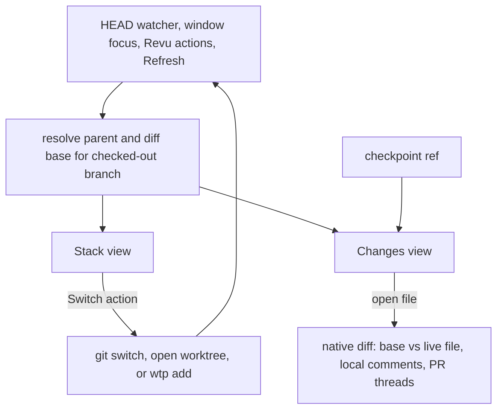

# Stack Review Design Doc

**TL;DR:** Revu stops asking for a review scope and instead always reviews the checked-out branch against its parent: the branch below it in a stack, or `origin/<default>`. A new Stack view shows where the branch sits among local branches and worktrees and switches between them, and a new Changes view shows the branch-vs-parent diff with a toggle that narrows it to changes since the checkpoint. The guide feature is removed.

**Problem:** Reviewing agent-written branches in Revu is noisy and manual in four ways.

- Every base is computed from the local default branch, and Revu never fetches. `defaultBranch` (`src/git.ts:43`) returns `main`, never `origin/main`, and it feeds the branch scope (`src/commands/startReview.ts:60`), the implicit checkpoint (`src/checkpoint.ts:50-54`), the reviewed-commit list (`src/checkpoint.ts:99-100`) and the Set Checkpoint picker (`src/commands/checkpoint.ts:147-148`). Agents only sometimes fast-forward the root worktree, so when a branch was cut from a newer `origin/main` than the local `main`, upstream commits leak into the diff.
- A stacked branch is diffed against the default branch, so the layers below it show up in its diff. `fetchPrMetadata` (`src/github/gh.ts:35`) fetches the PR's `baseRefName` but nothing uses it, and most stacks have no PR yet.
- Revu has no idea that stacks or other worktrees exist. Moving to another layer means finding its worktree by hand, opening it, and starting a review again through the scope picker.
- Pulling the default branch or merging it into a feature branch means leaving the editor for a terminal.

Session history shows how branches actually get made, since agents create them rather than Brodie: of about 840 `wtp add -b` calls, 620 branch from `main`, 142 branch from the current `HEAD` (often a feature worktree, so an unrecorded stack), and 73 name another feature branch as the base. `gh stack` appears in 26 sessions, and its stacks keep every layer in one worktree. wtp records no parent anywhere (its `state.json` holds only archive metadata), so most stacks are only discoverable from commit history.

**Goal:** Opening any branch in VS Code shows, with no commands run, its diff against its parent without upstream or lower-layer noise, where it sits in its stack, and each layer's PR if it has one. Pulling the default branch, merging the parent in, and jumping to another layer are one action each.

**Scope:**
- In: parent resolution with a per-branch override; trunk as `origin/<default>`; Pull Default Branch; Merge Parent; a Stack view with switching between layers; a Changes view with a checkpoint toggle; every base computation, including the checkpoint's implicit base, moving to the parent merge-base; local comments and PR threads following the checked-out branch.
- Removed: guide generation, the guide tree, the guide panel, the guide cache, the `revu.agent*` settings, Start Review, End Review and the scope picker (including the working tree vs `HEAD` scope, which the built-in git extension covers), and the Checkpoint view's "All unreviewed changes" node, which the Changes view replaces.
- Out: any GitHub write, `git push`, or `gh stack` mutation; rebasing; creating stacks or PRs; branches that exist only on the remote (`wtp add --pr` covers that); siblings of the current branch in the Stack view; listing every worktree when on the default branch (worth adding if it's missed); merging a whole stack top to bottom in one action.

**Constraints:**
- Read-only toward GitHub stays a hard guarantee, enforced by `src/test/readonly.test.ts`.
- `gh` and the `gh stack` extension stay optional. Any failure from either, including a missing extension or exit 2 ("not in a stack"), means that source doesn't apply; anything other than exit 2 is logged.
- Worktrees are created only through `wtp`, never `git worktree add`, so they land where Brodie and his agents look for them and setup hooks run. `wtp add <existing-branch>` attaches an existing branch (per `wtp add --help`).
- Revu never discards or stashes uncommitted work. "Dirty" means tracked changes only (`git status --porcelain --untracked-files=no`), since `git switch` and `git merge` carry untracked files safely and agents leave scratch files around.
- Git state stays the source of truth: the parent override is git config and the checkpoint stays a ref, so terminal git and agents can read and change both.

**Design:**

*Trunk.* The trunk ref is `origin/<trunk>` whenever that remote ref exists, falling back to the local branch without an `origin` remote. The trunk name is the default branch from `origin/HEAD`, or the gh stack's `trunk` when the branch is in one (so a stack on a release branch works). One function computes every diff base; the local-default-branch paths listed under Problem are deleted.

*Parent resolution,* first match wins. Each source yields a parent ref and a diff base, and the diff base is what the Changes view and the implicit checkpoint use:

| Order | Source | Parent | Diff base |
|---|---|---|---|
| 1 | Override in `branch.<name>.revuParent`, when that branch still exists | the named branch | merge-base with it |
| 2 | `gh stack view --json`, for every branch the stack lists | the nearest layer below it with `isMerged` false, else trunk | the branch's recorded `base` SHA when it's an ancestor of `HEAD`, else the merge-base |
| 3 | The branch's PR, when its state is `OPEN` | `baseRefName`: trunk when it names the trunk, else the local branch, else `origin/<base>`, else skip this rule | merge-base |
| 4 | Inference (below) | the chosen branch | merge-base |
| 5 | Trunk | `origin/<trunk>` | merge-base |

The gh stack base SHA matters when a lower layer was amended but not restacked: the merge-base with the amended branch would sit below the old commits and leak them in. An override whose branch was deleted falls through to rule 2, and the Changes view says "override target missing" next to Reset Parent.

*Inference* uses where each branch was created, which git records as the oldest entry in the branch's reflog: the commit it started at, and `branch: Created from <name>` when it was cut from a named branch (both `git branch` and `wtp add -b b a` write this; `wtp add -b b` from a feature worktree writes `Created from HEAD`). Ancestry alone can't tell parent from child: once both `a` and its child `b` have commits of their own, each looks like the other's fork. The creation point breaks the tie because only the child was created on top of the other. For branch `b` with creation commit `C` and trunk merge-base `T`:

- When `C` is on trunk (`C` is an ancestor of `origin/<trunk>`), `b` has no inferred parent and uses trunk.
- Otherwise the candidates are the other local branches (not trunk, no merged PR) whose history contains `C`. A candidate named in `Created from` wins. Otherwise the parent is the candidate whose merge-base with `b` is nearest to `b`, with ties going to a candidate in a worktree or gh stack, then alphabetical order, and the Changes view title says `(inferred, ambiguous)`.
- When the reflog has expired (git keeps entries for 90 days by default) or no candidate contains `C` (the parent was rebased), the fallback is the nearest candidate by fork point (`merge-base(b, c)` a strict descendant of `T`, `c` not containing `b`'s tip), labelled `(inferred, ambiguous)`.

A just-created branch with no commits resolves to its creator through `Created from`, so it appears under it in the Stack view with an empty diff. Every walk up a parent chain keeps a visited set; a cycle stops the walk, uses trunk, and shows a warning.

Compare With… in the Changes view title picks a local branch and writes the override; Reset Parent deletes it. The Changes view title shows the parent and its source, e.g. `vs feat/port (inferred)` or `vs main (PR)`.

*Stack view.* A tree rooted at trunk: the current branch's chain of parents down to trunk, then the current branch's descendants (local branches whose resolved parent chain reaches it). Siblings are left out. Each row shows the branch name and, as its description, the PR number and state (or "no PR"), commits ahead of and behind its parent, "needs rebase" when gh stack reports it, and an icon when it's checked out in another worktree. The current branch is highlighted.

Selecting a row does nothing beyond selection, because switching can reload the window and a stray click shouldn't do that. The actions are inline:

- **Switch** on a branch with no worktree, or the current worktree's other gh-stack layers: `git switch` when the worktree is clean. When it's dirty, it refuses and offers Create Worktree, which runs `wtp add <branch>` and opens the result in this window.
- **Switch** on a branch checked out in another worktree opens that folder in the current window. **Open in New Window** covers the rare case of wanting both.
- The trunk row's Switch opens the root worktree.
- **Open PR** opens the PR URL in the browser.
- Title actions: Pull Default Branch, Merge Parent, Refresh.

*Pull Default Branch* fetches `origin`, then fast-forwards the root worktree when it's on the default branch and clean. When it can't (dirty, on another branch, diverged), it says why the root stayed behind; trunk is `origin/<default>` either way, so the diff is already correct.

*Merge Parent* fetches first when the parent is trunk, then runs `git merge --no-edit <parent ref>`. It refuses when the worktree is dirty. On a conflict it leaves the merge in progress and opens the Source Control view, so resolution happens in VS Code's merge editor; Revu doesn't abort or continue on your behalf. When the branch is in a gh stack, whatever its parent's source, Merge Parent is hidden and the row's "needs rebase" points at `gh stack rebase --upstack`, since a later restack would flatten Revu's merge commit anyway. After a merge without conflicts, if the checkpoint was at the pre-merge `HEAD`, Revu moves it to the merge commit.

*Changes view.* Files changed between the diff base and the working tree, including uncommitted and untracked files, as a folder tree. Files with unresolved conflicts show with a conflict marker rather than disappearing (today `parseNameStatus` drops `U` entries, `src/git.ts:73`). Clicking a file opens the native diff with the live file on the right so local comments work, as the Checkpoint view's working-tree diffs do today. A title-bar toggle switches to checkpoint mode: the base becomes the checkpoint ref, so only files changed since the last reviewed commit are listed. Checkpoint mode lists only files that the default mode also lists. After a merge from the parent, the default mode's merge-base moves up to the parent's tip, so files that only the parent changed drop out of both modes even when the checkpoint stayed below the merge. A file changed by both the parent and the branch stays listed, and its diff shows the parent's hunks too. The toggle is per window, not persisted, and disabled with the Checkpoint view's existing message when the checkpoint is orphaned. On the default branch itself, the view says "on trunk" and diffs against `origin/<default>`, which shows unpushed commits and working-tree changes. With a detached `HEAD` (including mid-rebase), both views show a detached message and nothing else.

*Checkpoints.* The implicit checkpoint becomes the diff base above, so checkpoint mode with no explicit checkpoint lists the same files as the default mode, and the reviewed-commit list and Set Checkpoint picker start from the same base. Merge commits in the Checkpoint view diff against the tree an automatic merge of their parents would produce (`git merge-tree --write-tree <p1> <p2>`), so a merge row shows only conflict resolutions and edits made during the merge rather than the whole parent diff. That tree is a real git object, so it opens through the existing `revu-git:` content provider like any other ref. Everything else in the Checkpoint view stays.

*Review state follows the branch.* The Changes view's current base replaces the active scope. Comments already live in `workspaceState`, which is per folder, so separate worktrees are already isolated; switching branches in place (gh stack layers) is what needs per-branch keys. Comments are stored per branch name, and the existing list migrates once to whichever branch is checked out. On a branch change, Revu disposes the rendered comment threads and restores that branch's set, and Copy All Comments and Clear All Comments act on it. With a detached `HEAD`, comments are hidden and new ones refused. PR threads refresh for the checked-out branch's own PR on each branch change, so a lower layer's threads never render on a higher one; threads stay anchored to their recorded lines as today.

*Refresh.* The existing watcher only sees this worktree's `HEAD` reflog (`src/gitWatcher.ts:43-46`), which covers commits, checkouts and resets here. Changes it can't see (commits to the parent from another worktree, fetches, checkpoint moves from the terminal, override edits) are picked up when the VS Code window regains focus, which is when Brodie comes back from the terminal. Every Revu action refreshes when it finishes. A refresh reads the branch graph in a fixed number of git calls (ref tips, and the commits not on trunk with their parents), takes each branch's creation entry from the first line of its reflog file under the common git dir's `logs/refs/heads/`, and computes parents, merge-bases and ahead and behind counts in memory, so its cost doesn't grow with the number of branches. A focus refresh is skipped when `HEAD`, the branch tips, the checkpoint refs and `.git/config` are unchanged since the last one. PR data comes from `gh pr list --state all --limit 200` (the default limit is 30) per branch change and per explicit Refresh, cached in memory, preferring a branch's open PR when it has several. The current branch also gets `gh pr view` as today, so its own PR is right even when it's older than the batch. `gh stack view --json` runs at the same times. Revu never fetches from `origin` except in Pull Default Branch and Merge Parent, so ahead and behind counts are relative to the last fetch.

**Decisions:**

### Does the local default branch take any part in diffs?

**No; trunk is `origin/<default>`.** Comparing against the remote ref removes upstream noise without depending on anyone having pulled the root worktree, which is the cause of the noise. Declined: comparing against local `main` and requiring a pull first, because agents don't pull reliably and the diff would silently be wrong until someone did. Pull Default Branch still fast-forwards the root worktree because Brodie reads the latest code there.

### Does an explicit override beat gh stack and the PR base?

**Yes, override first.** In the order we first discussed (gh stack, then PR, then override), Compare With… would do nothing on any branch with a PR or a gh stack, which is exactly when you'd reach for it. An override is a deliberate act and Reset Parent undoes it.

### How is the parent found for stacks nothing recorded?

**From the branch's creation reflog entry, falling back to fork points, recomputed on every refresh; Compare With… persists a correction.** Git already records where every branch started, which is the asymmetric fact needed: rules based only on ancestry either lose the parent when it gains a commit (containment) or let a moving parent pick its own child (fork point). Declined: asking for the parent when a branch is created, because agents create the branches; recording the inferred parent in config automatically, because a wrong guess would then outlive the branch that caused it.

### Merge or rebase to bring the parent in?

**Merge.** It rewrites no history, so checkpoint refs stay valid, and conflicts resolve in VS Code's merge editor. Limiting checkpoint mode to the default mode's files and diffing merge commits against their automatic merge keep most merged-in parent changes out of the review. gh-stack layers are the exception, where `gh stack rebase --upstack` from the terminal stays the tool.

### What does Switch do for a branch with no worktree?

**`git switch` in place when the worktree is clean, otherwise offer to create a worktree.** gh stack already keeps all layers in one worktree, so switching in place matches how those stacks are built. A dirty worktree is usually an agent's work in progress.

### Where does a switch to another worktree open?

**In the current window, replacing its folder, with Open in New Window as an alternative.** One window per review keeps the Revu views about one branch.

### Why remove the guide and the scope picker?

**Brodie doesn't use the guide, and the Changes view makes the scope implicit.** The guide accounts for most of the code that knows about scopes (`src/guide/`, its cache, staleness tracking and agent settings), so removing it is what makes "the review is the branch" simple.

### Does Revu now write to git?

**Yes, locally: `fetch`, a fast-forward of the root worktree, `merge`, `switch`, the checkpoint move after a merge, the parent override, and `wtp add`.** These are the manual steps Brodie wanted gone. GitHub stays read-only, and the guard test gains patterns for `git push` and the writing `gh stack` subcommands (`push`, `submit`, `sync`, `merge`, `rebase`, `link`). The patterns are anchored to the `stack` token so Revu's own `git merge` doesn't trip them.

### Declined review suggestions

- Fetch-only Pull Default Branch, dropping the root fast-forward: Brodie chose the fast-forward with a fallback.
- Behind counts on the current row only: they're cheap local counts, and a stale count still says roughly how far a layer has drifted.
- Watching the common git dir's refs and config: refreshing on window focus covers the same changes with no new watcher code. If the views are seen to go stale while the window has focus (an agent running in the integrated terminal), add the watchers then.

**Risks and Tradeoffs:**
- Inference can still choose wrongly, most likely after the reflog expires or the parent is rebased, or when a branch with a squash-merged PR is still around locally but isn't in the cached PR list. The view always names the parent and its source, and Compare With… fixes it. If overrides turn out to be needed on most stacked branches, inference is the wrong default and parents should be recorded at creation time instead.
- `gh pr list` returns the 200 most recent PRs across all authors, so in a busy repo an older branch other than the current one may show "no PR" wrongly.
- In checkpoint mode, a file changed by both the parent and the branch shows the parent's hunks too. If that turns out to be common noise, the next step is diffing such files against the merge commit's automatic merge as the commit rows do.
- Ahead and behind counts go stale between fetches. Accepted to avoid background network calls.
- Replacing the window's folder reloads the extension host and drops open editors. Accepted because Brodie asked for it, with Open in New Window as the escape.
- Removing the guide deletes a working feature. If guides are missed, they come back as an action on the Changes view rather than a scope.

**Success Criteria:**
- [ ] On a branch cut from a newer `origin/main` than the local `main`, the Changes view lists only the branch's own files.
- [ ] Pull Default Branch fast-forwards a clean root worktree; with a dirty root it reports why it didn't and the Changes view is still correct.
- [ ] Right after `wtp add -b b --stay a` (`a` a feature branch), `b` shows `vs a (inferred)` with no files and sits under `a` in the Stack view. After commits on `b` and then on `a`, `b` still shows `vs a` with only its own changes, and `a` still shows `vs main` with all of its own.
- [ ] Two overrides pointing at each other show a cycle warning and fall back to trunk without hanging.
- [ ] For a gh stack `main <- a <- b`, the parent of `b` is `a` (gh stack); once `a` is merged, `b`'s parent is trunk; the Stack view shows `main`, `a`, `b` in order with PR state where PRs exist.
- [ ] Compare With… writes `branch.<name>.revuParent` and the Changes view switches to that parent; Reset Parent restores the resolved one; deleting the override's branch shows "override target missing".
- [ ] Merge Parent with new parent commits merges them; with a conflict it stops with the merge in progress, opens Source Control, and the conflicted files show in the Changes view; with tracked uncommitted changes it refuses and changes nothing; on a gh-stack layer it isn't offered.
- [ ] After Merge Parent with the checkpoint one commit behind `HEAD`, checkpoint mode lists that commit's files and none that only the parent changed.
- [ ] A merge commit's row in the Checkpoint view lists only files where the merge differs from the automatic merge of its parents.
- [ ] Switch on a layer checked out in another worktree opens that folder in the current window; Open in New Window keeps the current one; clicking a row alone never switches.
- [ ] Switch on a layer with no worktree from a clean worktree (untracked files allowed) switches to it; from a worktree with tracked changes it offers Create Worktree and never switches.
- [ ] A commit made on the parent from another worktree shows in the Stack view's behind count after the window regains focus, and refocusing with nothing changed runs no git commands beyond the change check.
- [ ] Toggling checkpoint mode after marking a commit safe lists only files changed after it; with no checkpoint both modes list the same files.
- [ ] Comments left on branch `a` aren't shown or exported after switching in place to `b`, and reappear after switching back.
- [ ] Switching branches re-renders PR threads for the new branch's PR, or clears them when it has none.
- [ ] No guide, Start Review or End Review command remains, and the read-only guard test fails if `git push` or a writing `gh stack` subcommand appears in `src` but passes with Revu's own `git merge`.

**Context Files:**
- `src/git.ts`: `defaultBranch`, `mergeBase`, `parseNameStatus` and `hasUncommittedChanges`, all of which change.
- `src/checkpoint.ts`: `getCheckpointState` and `reviewedCommits`, whose bases move to the parent diff base.
- `src/commands/checkpoint.ts`: the Set Checkpoint picker's merge-base option.
- `src/checkpointTree.ts`: the Checkpoint view; its working-tree node moves to the Changes view, and its file rows show how diffs open today.
- `src/commands/checkpointDiff.ts`, `src/gitContentProvider.ts`: working-tree and commit diff opening to reuse; merge commits diff against the `merge-tree` result.
- `src/scope.ts`, `src/commands/startReview.ts`, `src/commands/activateScope.ts`, `src/checkpointGuard.ts`: scope plumbing to replace with the Changes view's base.
- `src/gitWatcher.ts`: the `HEAD`-only watcher, joined by the window-focus refresh.
- `src/github/gh.ts`: PR metadata and threads; gains `state`, the batched `gh pr list`, and `gh stack view --json`.
- `src/comments/store.ts`, `src/comments/controller.ts`: per-folder storage to key by branch, and thread restore that runs once today and needs teardown on branch change.
- `src/guide/`, `src/commands/generateGuide.ts`: removed.
- `src/test/readonly.test.ts`: the guard to extend.
- `plans/design-2026-07-18-review-extension.md`: declined worktree handling ("checked-out code only"); this doc reverses that.
- `plans/design-2026-12-08-checkpoint-reviews.md`: checkpoint semantics this builds on.
