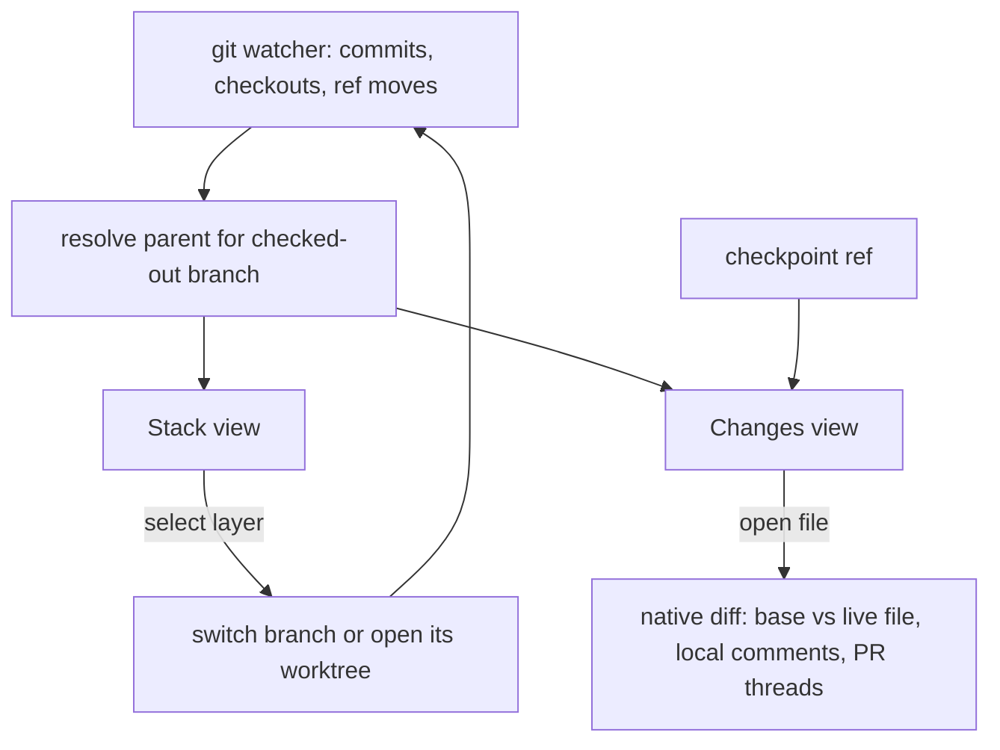

# Stack Review Design Doc

**TL;DR:** Revu stops asking for a review scope and instead always reviews the checked-out branch against its parent: the branch below it in a stack, or `origin/<default>`. A new Stack view shows where the branch sits among local branches and worktrees and switches between them, and a new Changes view shows the branch-vs-parent diff with a toggle that narrows it to changes since the checkpoint. The guide feature is removed.

**Problem:** Reviewing agent-written branches in Revu is noisy and manual in four ways.

- Every base is computed from the local default branch (`defaultBranch` in `src/git.ts:43` returns `main`, never `origin/main`), and Revu never fetches. Agents only sometimes fast-forward the root worktree, so when a branch was cut from a newer `origin/main` than the local `main`, upstream commits leak into the branch diff.
- A stacked branch is diffed against the default branch, so the layers below it show up in its diff. `fetchPrMetadata` (`src/github/gh.ts:35`) already fetches the PR's `baseRefName` but nothing uses it, and most stacks have no PR yet.
- Revu has no idea that stacks or other worktrees exist. Moving to another layer means finding its worktree by hand, opening it, and starting a review again through the scope picker.
- Pulling the default branch or merging it into a feature branch means leaving the editor for a terminal.

Session history shows how branches actually get made, since agents create them rather than Brodie: of about 840 `wtp add -b` calls, 620 branch from `main`, 142 branch from the current `HEAD` (often a feature worktree, so an unrecorded stack), and 73 name another feature branch as the base. `gh stack` appears in 26 sessions, and its stacks keep every layer in one worktree. wtp records no parent anywhere (its `state.json` holds only archive metadata), so most stacks are only discoverable from commit ancestry.

**Goal:** Opening any branch in VS Code shows, with no commands run, its diff against its parent without upstream or lower-layer noise, where it sits in its stack, and each layer's PR if it has one. Pulling the default branch, merging the parent in, and jumping to another layer are one click each.

**Scope:**
- In: parent resolution with a per-branch override; trunk as `origin/<default>`; a Pull Default Branch action; a Merge Parent action; a Stack view with switching between layers; a Changes view with a checkpoint toggle; the checkpoint's implicit base becoming the parent merge-base; local comments and PR threads following the checked-out branch.
- Removed: guide generation, the guide tree, the guide panel, the guide cache, the `revu.agent*` settings, Start Review, End Review and the scope picker (including the working tree vs `HEAD` scope, which the built-in git extension covers), and the Checkpoint view's "All unreviewed changes" node, which the Changes view replaces.
- Out: any GitHub write, `git push`, or `gh stack` mutation (the read-only guard is extended to cover them); rebasing (Merge Parent merges); creating stacks or PRs; branches that exist only on the remote (`wtp add --pr` covers that); a Stack view listing every worktree when on the default branch (worth adding if it's missed); merging a whole stack top to bottom in one action.

**Constraints:**
- Read-only toward GitHub stays a hard guarantee, enforced by `src/test/readonly.test.ts`.
- `gh` and the `gh stack` extension stay optional; without them Revu falls back to inference and shows no PR state.
- Worktrees are created only through `wtp`, never `git worktree add`, so they land where Brodie and his agents look for them and setup hooks run.
- Revu never discards or stashes uncommitted work. Any action that would touch a dirty worktree refuses and says why.
- Git state stays the source of truth: the parent override is git config and the checkpoint stays a ref, so terminal git and agents can read and change both.

**Design:**

*Trunk.* The trunk ref is `origin/<default>` whenever that remote ref exists, falling back to the local default branch without an `origin` remote. The default branch name comes from `origin/HEAD` as today. Nothing else uses the local default branch, which is what removes upstream noise whether or not the root worktree was pulled.

*Parent resolution,* first match wins:

| Order | Source | Parent ref |
|---|---|---|
| 1 | Override in `branch.<name>.revuParent` | the named branch |
| 2 | `gh stack view --json`, when the branch is in a gh stack | the branch listed before it, or trunk for the bottom layer |
| 3 | The branch's open PR, by `baseRefName` | that branch, or trunk when it names the default branch |
| 4 | Inference: the nearest local branch whose tip the branch contains, skipping the default branch and branches whose PR is merged or whose tip trunk already contains | that branch |
| 5 | Trunk | `origin/<default>` |

A parent that is another local branch is compared at its local ref, since stack layers often have unpushed commits. Every diff starts at the merge-base of the branch and its parent ref, never the parent's tip, so commits the parent gained after branching never appear. The Changes view title shows the parent and where it came from (for example `vs feat/port (inferred)`). "Compare With…" in the Changes view title picks a local branch and writes the override; "Reset Parent" deletes it.

*Stack view.* A tree rooted at trunk showing the current branch's family: its chain of parents down to trunk, and every local branch whose resolved parent chain passes through the bottom layer. With wtp inference two branches can share a parent, so the tree can fork. Each row shows the branch name and, as its description, the PR number and state (or "no PR"), commits ahead of its parent, commits behind it, and whether it lives in another worktree. The current branch is highlighted.

- Selecting a row in the current worktree (gh-stack layers) runs `git switch` when the worktree is clean. When it's dirty, Revu refuses and offers "Create Worktree", which runs `wtp add <branch>` and opens the result.
- Selecting a row checked out in another worktree opens that folder in the current window. An inline "Open in New Window" action covers the rare case of wanting both.
- A branch with no worktree, in a dirty current worktree, gets the same "Create Worktree" offer.
- An inline action on a row with a PR opens the PR URL in the browser.
- Title actions: Pull Default Branch, Merge Parent, Refresh.

*Pull Default Branch* fetches `origin`, then fast-forwards the root worktree when it's on the default branch and clean. When it can't (dirty, on another branch, diverged), it tells you why the root stayed behind and carries on; trunk is `origin/<default>` either way, so the diff is still correct.

*Merge Parent* fetches first when the parent is trunk, then runs `git merge --no-edit <parent ref>` in the current worktree. It refuses when the worktree is dirty. On a conflict it leaves the merge in progress and opens the Source Control view, so resolution happens in VS Code's merge editor; Revu doesn't abort or continue on your behalf.

*Changes view.* Files changed between the merge-base with the parent and the working tree, including uncommitted and untracked files, laid out as a folder tree. Clicking a file opens the native diff with the live file on the right so local comments work, as the Checkpoint view's working-tree diffs do today. A title-bar toggle switches to checkpoint mode: the base becomes the branch's checkpoint ref, so only files changed since the last reviewed commit are listed. The view title states which mode is on. The toggle is per window and not persisted.

*Checkpoints.* The implicit checkpoint (no ref yet) becomes the merge-base with the resolved parent instead of the default branch, so checkpoint mode with no explicit checkpoint shows the same files as the default mode. The Checkpoint view keeps its commit lists, Mark Safe, Move Checkpoint Here, Set and Remove Checkpoint, and commit diffs; only its "All unreviewed changes" node goes. The orphaned and detached states keep their current handling.

*Review state follows the branch.* The Changes view's current base replaces the active scope. Local comments are stored per branch, and Copy All Comments and Clear All Comments act on the current branch's set. PR threads refresh for the checked-out branch's own PR on every branch change, so a lower layer's threads never render on a higher one. Comments saved before this change attach to whichever branch is checked out the first time the new version runs.

*Refresh.* The existing git watcher drives everything. Revu never fetches on its own; ahead and behind counts are relative to the last fetch, and Pull Default Branch and Merge Parent fetch. PR state comes from `gh` and is cached between refreshes.

**Decisions:**

### Does the local default branch take any part in diffs?

**No; trunk is `origin/<default>`.** Comparing against the remote ref removes upstream noise without depending on anyone having pulled the root worktree, which is the root cause of the noise. Declined: comparing against local `main` and requiring a pull first, because agents don't pull reliably and the diff would silently be wrong until someone did.

### Does an explicit override beat gh-stack and the PR base?

**Yes, override first.** We discussed gh-stack, then PR, then override, but in that order "Compare With…" would do nothing on any branch with a PR or a gh stack, which is exactly when you'd reach for it. An override is a deliberate act and Reset Parent undoes it.

### How is the parent found for stacks nothing recorded?

**Infer it from ancestry on every refresh, and let Compare With… persist a correction.** Most stacks come from `wtp add -b X <branch>` or `wtp add -b X` from a feature worktree, and neither records the base. Declined: asking for the parent when a branch is created, because agents create the branches and wouldn't answer; recording the inferred parent automatically, because a wrong guess would then outlive the branch that caused it.

### Merge or rebase to bring the parent in?

**Merge.** It rewrites no history, so checkpoint refs and the review state of already-reviewed commits stay valid, and a conflict can be resolved in VS Code's merge editor. Rebasing would orphan every checkpoint on the branch. For gh-stack stacks, `gh stack rebase --upstack` from the terminal stays the tool for restacking.

### What does selecting a branch with no worktree do?

**Switch in place when the worktree is clean, otherwise offer to create a worktree.** gh stack already keeps all layers in one worktree, so switching in place matches how those stacks are built. A dirty worktree is usually an agent's work in progress, which a switch would carry along or block on.

### Where does a switch to another worktree open?

**In the current window, replacing its folder, with an inline action to open a new window instead.** One window per review keeps the Revu views about one branch.

### Why remove the guide and the scope picker?

**Brodie doesn't use the guide, and the Changes view makes the scope implicit.** The guide accounts for most of the code that knows about scopes (`src/guide/`, its cache, staleness tracking and agent settings), so removing it is what makes "the review is the branch" simple. The working tree vs `HEAD` scope goes with the picker; the built-in git extension shows uncommitted changes.

### Does Revu now write to git?

**Yes, locally: `fetch`, a fast-forward of the root worktree, `merge`, `switch`, the parent override, and `wtp add`.** These were the manual steps Brodie wanted removed. GitHub stays read-only, and the guard test gains patterns for `git push` and the `gh stack` subcommands that write (`push`, `submit`, `sync`, `merge`, `rebase`, `link`), so a write path to the remote can't slip in through stacks.

**Risks and Tradeoffs:**
- Inference can pick the wrong parent, most likely when a squash-merged branch is still around locally or two candidates sit on the same commit. The view always names the parent and its source, and Compare With… fixes it. If overrides turn out to be needed on most stacked branches, inference is the wrong default and the design should record parents at creation time instead.
- Computing the family means inspecting every local branch on each refresh. That's cheap at Brodie's scale; if the Stack view lags after commits in a repo with hundreds of local branches, limit candidates to branches in a worktree or a gh stack.
- Ahead and behind counts go stale between fetches. Accepted to avoid background network calls.
- Replacing the window's folder reloads the extension host and drops open editors. Accepted because it's what Brodie asked for, with Open in New Window as the escape.
- Removing the guide deletes a working feature. If guides are missed, they come back as an action on the Changes view rather than a scope.

**Success Criteria:**
- [ ] On a branch cut from a newer `origin/main` than the local `main`, the Changes view lists only the branch's own files.
- [ ] Pull Default Branch fast-forwards a clean root worktree; with a dirty root it reports why it didn't and the Changes view is still correct.
- [ ] For `wtp add -b b --stay a` where `a` is a feature branch, opening `b` shows `vs a (inferred)` and only `b`'s changes.
- [ ] For a gh stack `main <- a <- b`, the parent of `b` is `a` (gh-stack), and the Stack view shows `main`, `a`, `b` in order with PR state where PRs exist.
- [ ] Compare With… on a branch writes `branch.<name>.revuParent`, the Changes view switches to that parent, and Reset Parent restores the resolved one.
- [ ] Merge Parent with commits on the parent merges them; with a conflict it stops with the merge in progress and opens Source Control; with uncommitted changes it refuses and changes nothing.
- [ ] Selecting a layer checked out in another worktree opens that folder in the current window; Open in New Window keeps the current one.
- [ ] Selecting a layer with no worktree from a clean worktree switches to it; from a dirty worktree it offers Create Worktree and never switches.
- [ ] Toggling checkpoint mode after marking a commit safe lists only files changed after it; with no checkpoint both modes list the same files.
- [ ] Comments left on branch `a` aren't shown or exported on branch `b`, and reappear after switching back.
- [ ] Switching branches re-renders PR threads for the new branch's PR, or clears them when it has none.
- [ ] No guide, Start Review or End Review command remains, and the read-only guard test fails if `git push` or a writing `gh stack` subcommand appears in `src`.

**Context Files:**
- `src/git.ts`: `defaultBranch` and `mergeBase`, where the local default branch is used today.
- `src/checkpoint.ts`: `getCheckpointState`, whose implicit base becomes the parent merge-base.
- `src/checkpointTree.ts`: the Checkpoint view; its working-tree node moves to the Changes view and its file rows show how diffs open today.
- `src/commands/checkpointDiff.ts`: working-tree and commit diff opening to reuse.
- `src/scope.ts`, `src/commands/startReview.ts`, `src/commands/activateScope.ts`, `src/checkpointGuard.ts`: scope plumbing to replace with the Changes view's base.
- `src/github/gh.ts`: PR metadata and threads; gains the batched PR state lookup and `gh stack view --json`.
- `src/comments/store.ts`: the single global comment list to key by branch.
- `src/guide/`, `src/commands/generateGuide.ts`: removed.
- `src/test/readonly.test.ts`: the guard to extend.
- `plans/design-2026-07-18-review-extension.md`: declined worktree handling ("checked-out code only"); this doc reverses that.
- `plans/design-2026-12-08-checkpoint-reviews.md`: checkpoint semantics this builds on.
